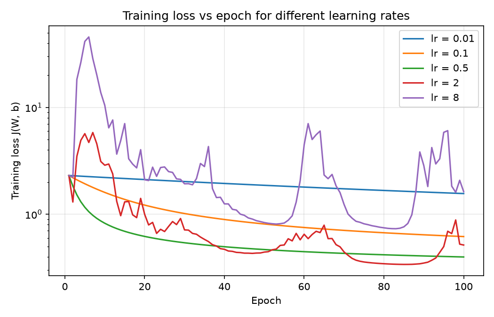
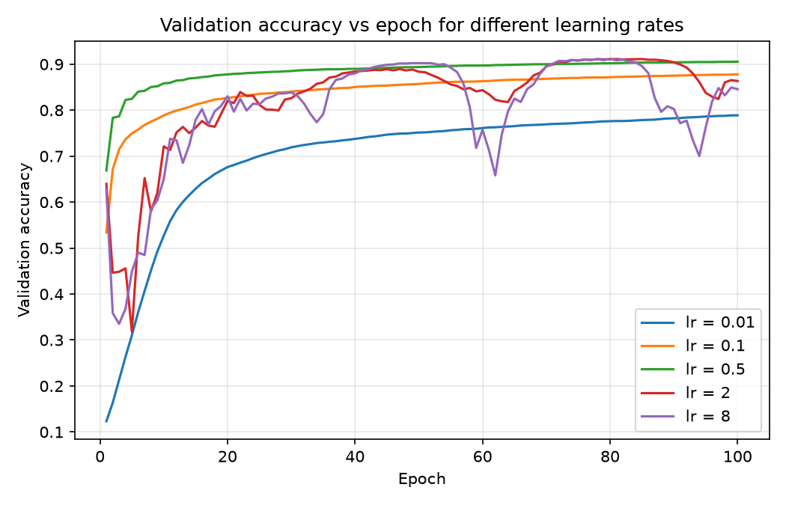
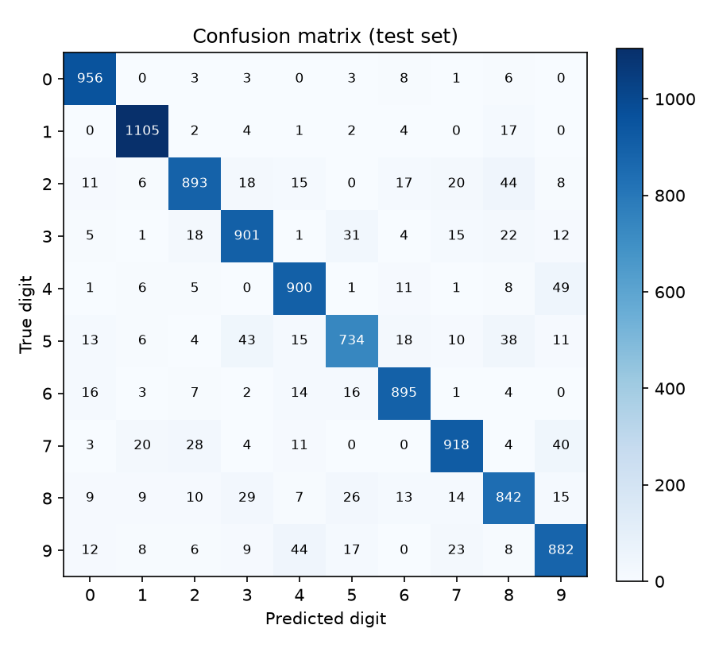
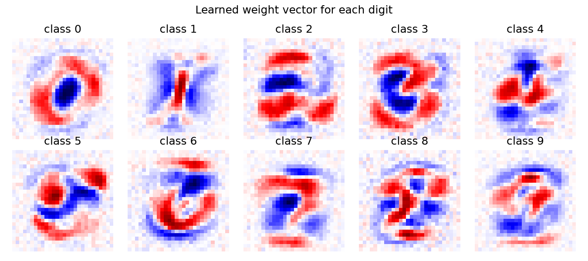

# Handwritten Digit Classification Using Gradient Descent

## 📌 Project Overview

This project explores how **Gradient Descent, a fundamental optimization technique from Calculus, can be used to train a machine learning model** to recognize handwritten digits from 0 to 9.

The project implements a Softmax Regression classifier using NumPy and the MNIST handwritten digit dataset. Instead of relying entirely on machine learning libraries, the model's core mathematical operations—including the loss function, gradients, and parameter updates—are implemented from scratch.

The project also investigates how different learning rates affect convergence, training loss, and classification accuracy.

## 🎯 Objectives

- Understand the mathematical foundations of Gradient Descent.
- Derive partial derivatives of the categorical cross-entropy loss function.
- Implement a handwritten digit classifier using NumPy.
- Analyze the impact of learning rates on optimization.
- Evaluate model performance using accuracy and a confusion matrix.
- Connect Calculus concepts with a practical Artificial Intelligence and Machine Learning application.

## 🧠 Problem Statement

Recognizing handwritten digits is a common image classification problem in machine learning. Given an image of a handwritten digit, the model must predict which digit it represents, from 0 to 9.

Each MNIST image contains 28 × 28 grayscale pixels. These pixels are converted into a feature vector and passed to a trainable classification model.

The challenge is to find suitable model parameters that minimize prediction error. Gradient Descent solves this optimization problem by iteratively updating the model parameters in the direction opposite to the gradient of the loss function.

## 📊 Dataset

**MNIST Handwritten Digit Dataset**

- **Classes:** 10 digits (0–9)
- **Image dimensions:** 28 × 28 pixels
- **Features per image:** 784 pixel values
- **Pixel values:** 0–255, normalized to 0–1
- **Task:** Multiclass classification

Dataset source: [MNIST Database of Handwritten Digits](https://yann.lecun.com/exdb/mnist/)

The 60,000 MNIST training images are split into 50,000 for training and 10,000 for validation (used to choose the learning rate). The standard 10,000 MNIST test images are used once, for the final evaluation.

## 🧮 Mathematical Formulation

### 1. Model

Let \(x_i \in \mathbb{R}^{784}\) represent the flattened image of the \(i\)-th digit.

The model calculates a score for each of the ten classes:

\[
z_i = Wx_i+b
\]

where:

- \(W\in\mathbb{R}^{10\times784}\) is the weight matrix.
- \(b\in\mathbb{R}^{10}\) is the bias vector.
- \(z_i\in\mathbb{R}^{10}\) contains the class scores.

The Softmax function converts these scores into class probabilities:

\[
p_{ik}=\frac{e^{z_{ik}}}{\sum_{j=0}^{9}e^{z_{ij}}}
\]

The predicted digit is the class with the highest probability.

### 2. Objective Function

The model is trained by minimizing categorical cross-entropy:

\[
J(W,b)=-\frac{1}{N}\sum_{i=1}^{N}\log p_{i,y_i}
\]

where:

- \(N\) is the number of training examples.
- \(y_i\) is the correct class of image \(i\).
- \(p_{i,y_i}\) is the probability assigned to the correct class.

The objective is to find parameters \(W\) and \(b\) that minimize \(J(W,b)\).

### 3. Gradient Descent

The gradient measures how the loss changes with respect to the model parameters.

For the weight associated with class \(k\):

\[
\frac{\partial J}{\partial w_k}
=\frac{1}{N}\sum_{i=1}^{N}
(p_{ik}-\mathbf{1}[y_i=k])x_i
\]

For the bias:

\[
\frac{\partial J}{\partial b_k}
=\frac{1}{N}\sum_{i=1}^{N}
(p_{ik}-\mathbf{1}[y_i=k])
\]

The parameters are updated iteratively:

\[
W_{t+1}=W_t-\alpha\nabla_WJ
\]

\[
b_{t+1}=b_t-\alpha\nabla_bJ
\]

Here, \(\alpha\) is the learning rate, which controls the size of each optimization step.

### 4. Learning Rate Analysis

The project compares five learning rates (0.01, 0.1, 0.5, 2 and 8) to understand their effects on convergence.

- **Too small:** Training may converge slowly.
- **Appropriate:** The loss generally decreases steadily.
- **Too large:** Optimization may oscillate or become unstable.

Training loss and validation accuracy are plotted against epochs to compare the behavior of different learning rates.

## ⚙️ Technologies Used

- **Python** — programming language
- **NumPy** — numerical computation and gradient calculations
- **Matplotlib** — plotting loss curves and sample predictions
- **Scikit-learn** — evaluation metrics and confusion matrix
- **Jupyter Notebook** — experimentation and visualization
- **Streamlit** + **streamlit-drawable-canvas** — drawing demo
- **Pillow** — resizing drawn digits for the demo

The model's core training algorithm is implemented in NumPy rather than with a deep learning framework. Scikit-learn is used only for the confusion matrix.

## 📁 Project Structure

```text
handwritten-digit-gradient-descent/
│
├── data/                         # MNIST is downloaded here on the first run (not in git)
├── notebooks/
│   └── digit_classification.ipynb  # step-by-step experiments, observations, conclusions
├── src/
│   ├── data.py                   # download/cache MNIST, scale to 0-1, split
│   ├── model.py                  # Softmax classifier: loss, gradients, predict, save/load
│   ├── train.py                  # Gradient Descent loop and learning-rate sweep
│   ├── evaluate.py               # accuracy, confusion matrix, plots
│   ├── gradcheck.py              # analytic vs numerical gradient check
│   └── preprocess.py             # turns a canvas drawing into a 28x28 MNIST-style input
├── results/                      # plots and trained weights (weights.npz)
├── run_all.py                    # whole pipeline in one command
├── app.py                        # Streamlit drawing demo
├── requirements.txt
├── README.md, PROJECT.md, PROGRESS.md, ARCHITECTURE.md
└── .gitignore
```

## 🚀 Installation and Usage

### 1. Clone the repository

```bash
git clone https://github.com/Pdpriya62/handwritten-digit-gradient-descent.git
cd handwritten-digit-gradient-descent
```

### 2. Create a virtual environment and install dependencies

```bash
python -m venv .venv
.venv\Scripts\activate          # Windows (PowerShell: .venv\Scripts\Activate.ps1)
source .venv/bin/activate        # macOS/Linux
pip install -r requirements.txt
```

### 3. Run the project

```bash
python run_all.py                                       # downloads MNIST once (~11 MB), trains, saves plots + results/weights.npz
jupyter notebook notebooks/digit_classification.ipynb   # step-by-step experiments
streamlit run app.py                                    # draw a digit and get a prediction
```

In VS Code you can also open the notebook directly and choose the `.venv` kernel.

`python run_all.py --epochs 200 --lrs 0.01 0.1 0.5 2 8` changes the epochs and learning rates. `python run_all.py --dataset digits` runs a small offline smoke test on the 8x8 scikit-learn digits.

## 📈 Results and Evaluation

Full-batch Gradient Descent, 100 epochs, same data split and initial weights (seed 0) for every learning rate.

**Gradient check:** relative error between analytic and numerical gradients = `1.70e-10`. Loss of the untrained model = `2.3058` (expected about ln 10 = `2.3026`).

| Learning rate | Final train loss | Final validation accuracy |
|---|---|---|
| 0.01 | 1.5622 | 0.7888 |
| 0.1 | 0.6180 | 0.8778 |
| **0.5** | **0.3980** | **0.9056** |
| 2 | 0.5149 | 0.8634 |
| 8 | 1.6277 | 0.8457 |

**Test set (best learning rate 0.5, chosen on validation accuracy):** accuracy **0.9026**, loss 0.3720.

- **0.01** is too small: the loss falls smoothly but is still 1.56 after 100 epochs.
- **0.1 and 0.5** converge smoothly; 0.5 is the fastest without instability.
- **2 and 8** are too large: the loss spikes repeatedly (above 40 for lr = 8) because the steps overshoot the minimum.
- Most common confusions (true -> predicted): 4 -> 9 (49), 9 -> 4 (44), 2 -> 8 (44), 5 -> 3 (43), 7 -> 9 (40).






## 🔬 Experiments

The following experiments were conducted:

1. Train the classifier using a baseline learning rate.
2. Compare small, moderate, and large learning rates.
3. Plot training loss across epochs.
4. Compare validation accuracy for each learning rate.
5. Investigate whether the loss converges or oscillates.
6. Inspect correctly classified and misclassified digit images.

For a fair comparison, every run uses the same data split, the same initial parameters (seed 0) and the same number of epochs.

## 📚 Calculus Concepts Demonstrated

This project connects theoretical Calculus with practical machine learning through:

- Partial derivatives of multivariable functions
- Gradients and directional change
- The chain rule used in differentiating the Softmax and cross-entropy composition
- Optimization of an objective function
- Iterative parameter updates
- Learning-rate effects on convergence

For Softmax Regression, the cross-entropy objective is convex in the model parameters under the standard formulation, although convergence speed depends on factors such as learning rate and data conditioning.

## 🌍 Real-World Applications

The concepts demonstrated in this project are relevant to:

- Digit recognition in postal codes and addresses
- Automated processing of handwritten forms
- Bank cheque and document processing
- Optical character recognition (OCR)
- Understanding optimization in larger neural networks

The implemented Softmax Regression model is a baseline classifier rather than a full deep neural network, but the Gradient Descent principles also apply to neural network training.

## 🔮 Future Improvements

- Implement mini-batch and stochastic Gradient Descent.
- Add L2 regularization.
- Compare Softmax Regression with a neural network.
- Experiment with momentum-based optimization.
- Study the effect of feature scaling and parameter initialization.

## 📄 License

This project may be released under the MIT License. Add a `LICENSE` file if you choose to publish it under that license.

---

**Key takeaway:** This project demonstrates how Calculus-based optimization enables a machine learning model to learn from data, while providing an opportunity to study gradients, objective functions, and convergence experimentally.
