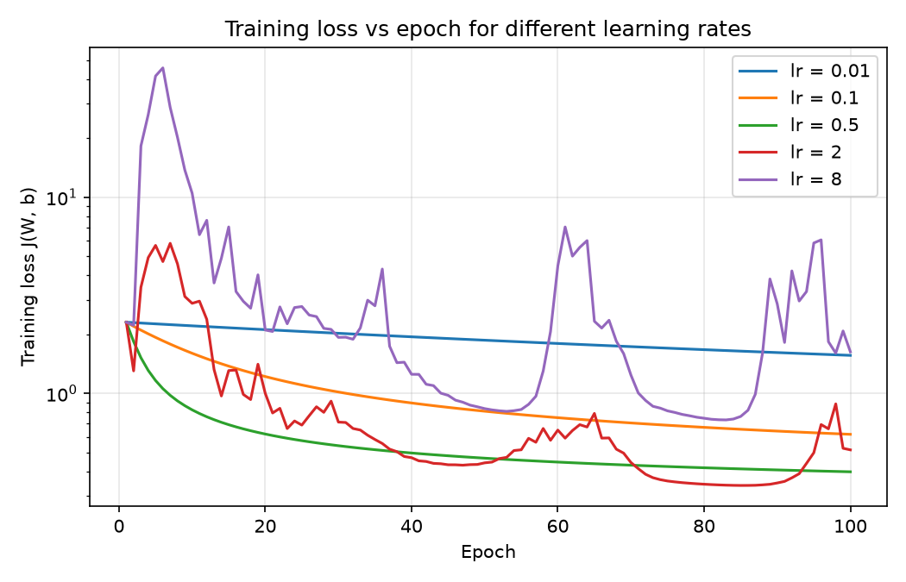
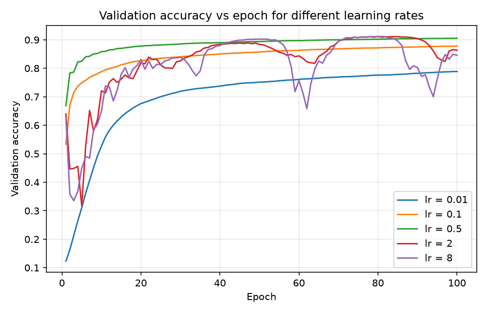
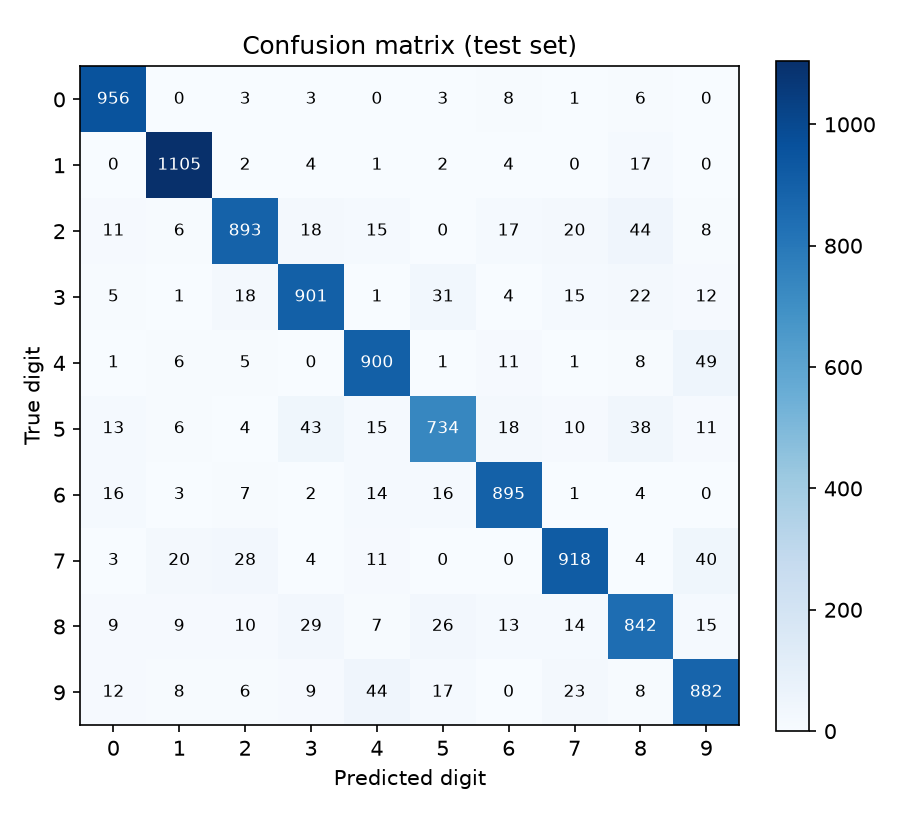
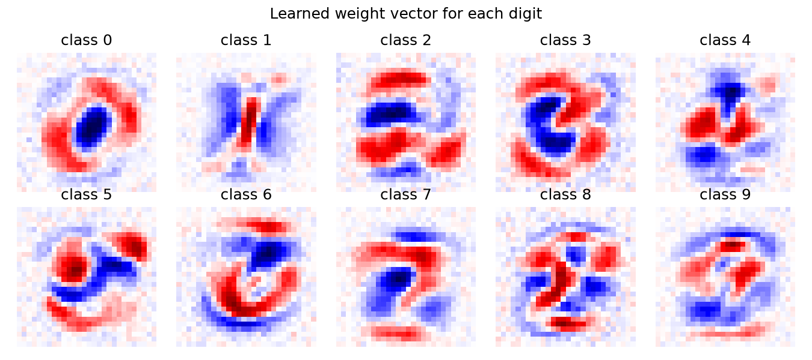

# Handwritten Digit Classification Using Gradient Descent

**Author:** Priyadarshini Prasad (Section D, AIML), RV University
**Course:** Calculus, applied to machine learning
**Code:** https://github.com/Pdpriya62/handwritten-digit-gradient-descent

---

## 1. Problem Description

Banks read the amounts on cheques, post offices read PIN codes on envelopes, and offices digitise handwritten forms. In all of these, a computer must look at an image of a handwritten digit and decide which digit (0-9) it is. People write the same digit in many different ways: thick or thin strokes, slanted, open or closed loops. So simple fixed rules ("a 0 is a circle") do not work well.

Instead, we let the computer **learn** the rules from examples. This project uses the **MNIST** dataset of 70,000 handwritten digits. Each image is 28 x 28 grayscale pixels, so it can be written as a vector of 784 numbers (pixel brightness scaled from 0-255 to 0-1).

| Split | Images | Used for |
|---|---|---|
| Training | 50,000 | Learning the model parameters |
| Validation | 10,000 | Choosing the learning rate |
| Test | 10,000 | Final, one-time evaluation |

The model is **Softmax Regression** (multinomial logistic regression). Learning means finding the parameter values that make the model's predictions as close as possible to the true labels. This is an **optimization problem**, and we solve it with **Gradient Descent**, implemented from scratch in NumPy. We also study how the **learning rate** (step size) affects whether Gradient Descent converges.

---

## 2. Mathematical Formulation

### 2.1 Model

For an image $x_i \in \mathbb{R}^{784}$, the model computes one score per digit:

$$
z_i = W x_i + b, \qquad W \in \mathbb{R}^{10 \times 784},\; b \in \mathbb{R}^{10},\; z_i \in \mathbb{R}^{10}
$$

The **Softmax** function turns the scores into probabilities:

$$
p_{ik} = \frac{e^{z_{ik}}}{\sum_{j=0}^{9} e^{z_{ij}}}, \qquad k = 0, \dots, 9
$$

The predicted digit is $\hat{y}_i = \arg\max_k p_{ik}$.

### 2.2 Objective function

We minimise the **categorical cross-entropy** (average negative log-probability of the correct digit) over the $N = 50{,}000$ training images:

$$
\min_{W,\,b} \; J(W, b) = -\frac{1}{N} \sum_{i=1}^{N} \log p_{i, y_i}
$$

If the model gives the correct digit probability 1, the loss for that image is $-\log 1 = 0$. If it gives probability close to 0, the loss is very large. Before training, all 10 digits are about equally likely, so $J \approx -\log(1/10) = \ln 10 \approx 2.3026$.

### 2.3 Constraints

- **Probability constraints:** each $p_{ik} \ge 0$ and $\sum_k p_{ik} = 1$. These are not imposed separately: the Softmax function satisfies them automatically for any $W$ and $b$. So the optimization over $W$ and $b$ is **unconstrained**, which is what makes plain Gradient Descent possible.
- **Inputs:** pixel values are scaled to $0 \le x_{ij} \le 1$.
- **Learning rate:** $\alpha > 0$. It must also be small enough for Gradient Descent to be stable (see 2.6).

### 2.4 Gradient (chain rule)

For one image, write $\ell_i = -\log p_{i,y_i} = -z_{i,y_i} + \log \sum_j e^{z_{ij}}$. Differentiating with respect to a score $z_{ik}$:

$$
\frac{\partial \ell_i}{\partial z_{ik}} = -\mathbf{1}[y_i = k] + \frac{e^{z_{ik}}}{\sum_j e^{z_{ij}}} = p_{ik} - \mathbf{1}[y_i = k]
$$

Since $z_{ik} = w_k \cdot x_i + b_k$, we have $\partial z_{ik} / \partial w_k = x_i$ and $\partial z_{ik} / \partial b_k = 1$. By the **chain rule**:

$$
\frac{\partial J}{\partial w_k} = \frac{1}{N} \sum_{i=1}^{N} \left(p_{ik} - \mathbf{1}[y_i = k]\right) x_i,
\qquad
\frac{\partial J}{\partial b_k} = \frac{1}{N} \sum_{i=1}^{N} \left(p_{ik} - \mathbf{1}[y_i = k]\right)
$$

In matrix form, with $P$ the $N \times 10$ matrix of probabilities and $Y$ the one-hot label matrix:

$$
\nabla_W J = \frac{1}{N} (P - Y)^T X, \qquad \nabla_b J = \frac{1}{N} \sum_{i} (P - Y)_i
$$

The gradient has a simple meaning: (predicted probability minus truth), weighted by the input pixels.

### 2.5 Gradient Descent update

Starting from small random $W$ and $b = 0$, repeat for each epoch $t$:

$$
W_{t+1} = W_t - \alpha \, \nabla_W J, \qquad b_{t+1} = b_t - \alpha \, \nabla_b J
$$

The negative gradient is the direction in which $J$ decreases fastest, and $\alpha$ is the step size. We use **full-batch** Gradient Descent: every update uses all 50,000 training images.

### 2.6 Convexity and the learning rate

$J$ is **convex** in $(W, b)$: it is a linear function plus a log-sum-exp, which is convex. So there are no bad local minima, and any point where the gradient is zero is a global minimum.

Convexity alone does not guarantee convergence: the step size matters. If the gradient is $L$-Lipschitz (the curvature is at most $L$), Gradient Descent is guaranteed to decrease the loss when $\alpha < 2/L$. For softmax cross-entropy, the Hessian is bounded by

$$
L \le \tfrac{1}{2} \, \lambda_{\max}\!\left(\tfrac{1}{N} \tilde{X}^T \tilde{X}\right)
$$

where $\tilde{X}$ is $X$ with a column of ones added for the bias, and the factor $\tfrac12$ is the largest eigenvalue of the Softmax Jacobian $\operatorname{diag}(p) - pp^T$. On our training data, $\lambda_{\max} = 39.21$, so $L \le 19.60$ and the **guaranteed-safe** learning rate is $\alpha < 2/L \approx 0.102$. This bound is a worst case: larger rates can still work, but there is no guarantee.

---

## 3. Code Implementation

All of the math is implemented in NumPy (no machine learning library is used for the model). Scikit-learn is used only to compute the confusion matrix, and Matplotlib for the plots.

| File | Purpose |
|---|---|
| `src/data.py` | Download MNIST once, scale to 0-1, flatten, split 50k / 10k / 10k |
| `src/model.py` | Softmax, loss, gradients, predict, save/load |
| `src/train.py` | Gradient Descent loop and learning-rate sweep |
| `src/gradcheck.py` | Checks the analytic gradient against a numerical one |
| `src/evaluate.py` | Accuracy, confusion matrix and plots |
| `notebooks/digit_classification.ipynb` | Runs every experiment step by step |
| `run_all.py` | Runs the whole pipeline in one command |
| `app.py`, `src/preprocess.py` | Streamlit demo: draw a digit and get a prediction |

### 3.1 Stable Softmax (`src/model.py`)

Subtracting the row maximum before `exp` prevents overflow, and does not change the result because it cancels in the fraction.

```python
def log_softmax(z):
    """Numerically stable log(softmax(z)) along axis 1."""
    shifted = z - z.max(axis=1, keepdims=True)
    return shifted - np.log(np.exp(shifted).sum(axis=1, keepdims=True))
```

### 3.2 Loss and gradients (`src/model.py`)

This is a direct translation of section 2.4. `P[idx, y] -= 1.0` computes $P - Y$ without building the one-hot matrix.

```python
def loss_and_grads(self, X, y):
    """Return (J, dJ/dW, dJ/db) using one forward pass."""
    N = X.shape[0]
    logp = log_softmax(self.scores(X))
    idx = np.arange(N)
    J = float(-logp[idx, y].mean())
    P = np.exp(logp)
    P[idx, y] -= 1.0              # P - Y, without building the one-hot matrix
    dW = (X.T @ P).T / N          # same as P^T X; this order avoids a very slow BLAS path
    db = P.sum(axis=0) / N
    return J, dW, db
```

### 3.3 Gradient Descent loop (`src/train.py`)

Every run starts from the same initial weights (same `seed`), so runs that differ only in the learning rate can be compared fairly.

```python
for epoch in range(epochs):
    J, dW, db = model.loss_and_grads(Xtr, ytr)
    model.W -= lr * dW
    model.b -= lr * db

    hist["train_loss"].append(J)
    hist["val_loss"].append(model.loss(Xva, yva))
    hist["train_acc"].append(model.accuracy(Xtr, ytr))
    hist["val_acc"].append(model.accuracy(Xva, yva))
```

### 3.4 Gradient check (`src/gradcheck.py`)

To make sure the hand-derived gradient is correct, each parameter is nudged by $\pm h$ and the slope is measured numerically (the definition of the derivative):

$$
\frac{\partial J}{\partial \theta} \approx \frac{J(\theta + h) - J(\theta - h)}{2h}, \qquad h = 10^{-5}
$$

The relative error between this numerical gradient and the analytic one is then reported.

### 3.5 How to run

```bash
pip install -r requirements.txt
python run_all.py                                       # full pipeline, saves plots to results/
jupyter notebook notebooks/digit_classification.ipynb   # step-by-step experiments
streamlit run app.py                                    # drawing demo
```

---

## 4. Results and Discussion

**Setup:** full-batch Gradient Descent, 100 epochs, same data split and same initial weights (seed 0) for every learning rate.

### 4.1 The gradient is correct

- Relative error between analytic and numerical gradients: **1.70e-10**. This is far below the usual 1e-6 threshold, so the derivation in section 2.4 and the code agree.
- Loss of the untrained model: **2.3058**, close to the predicted $\ln 10 = 2.3026$.

### 4.2 Effect of the learning rate

| Learning rate $\alpha$ | Final training loss | Final validation accuracy | Behaviour |
|---|---|---|---|
| 0.01 | 1.5622 | 0.7888 | Smooth, too slow |
| 0.1 | 0.6180 | 0.8778 | Smooth |
| **0.5** | **0.3980** | **0.9056** | Smooth, best |
| 2 | 0.5149 | 0.8634 | Oscillates |
| 8 | 1.6277 | 0.8457 | Large spikes |





- **Too small ($\alpha = 0.01$):** the loss decreases at every step, but very slowly. After 100 epochs it is still 1.56, and validation accuracy is only 0.789. The direction is right, but the steps are too short.
- **Well chosen ($\alpha = 0.1$ and $0.5$):** the loss drops quickly in the first ~20 epochs and then keeps decreasing smoothly. $\alpha = 0.1$ is inside the guaranteed-safe range ($< 0.102$). $\alpha = 0.5$ is above that worst-case bound, but still converges smoothly, because the real curvature along the path is lower than the worst case. It gives the lowest loss (0.398) and the best validation accuracy (0.906).
- **Too large ($\alpha = 2$ and $8$):** the loss jumps **up** in the first few epochs (to about 6 for $\alpha = 2$, and above 40 for $\alpha = 8$), then partly recovers and spikes again several times. The step is so long that it overshoots the minimum to the other side of the "valley", where the loss is higher. Validation accuracy shows the same instability: for $\alpha = 8$ it falls to about 0.66 near epoch 62. Both runs briefly reach about 0.91 validation accuracy (around epochs 75-85) but cannot stay there, and they end worse than $\alpha = 0.5$.

This is exactly what the theory in section 2.6 predicts: the problem is convex, so it has one global minimum, but Gradient Descent only reaches it reliably when the step size matches the curvature of the loss.

### 4.3 Final test result

The learning rate was chosen using validation accuracy only ($\alpha = 0.5$). The test set was then used once:

| Metric | Value |
|---|---|
| Test accuracy | **0.9026** (9,026 of 10,000 digits correct) |
| Test loss | 0.3720 |

### 4.4 Where the model makes mistakes



Most common confusions on the test set (true digit -> predicted digit):

| True -> predicted | Count |
|---|---|
| 4 -> 9 | 49 |
| 9 -> 4 | 44 |
| 2 -> 8 | 44 |
| 5 -> 3 | 43 |
| 7 -> 9 | 40 |

These pairs have similar shapes. For example, a 4 and a 9 differ mainly in whether the top is closed.

### 4.5 What the model learned



Each row of $W$ has one weight per pixel, so it can be shown as a 28 x 28 image. Red pixels increase the score for that digit and blue pixels decrease it. Gradient Descent has turned each row into a rough template of its digit. For example, class 0 is a red ring with a blue centre: ink in the middle of the image is evidence *against* a 0.

### 4.6 How Gradient Descent helps solve the real-world problem

- **It turns "recognise digits" into "minimise a function".** The vague goal of reading handwriting becomes a precise calculus problem: minimise $J(W, b)$ over 7,850 parameters. No one has to write rules for each digit; the rules (the weight templates above) come out of the optimization.
- **The gradient tells each parameter how to change.** $(p_{ik} - \mathbf{1}[y_i = k])\,x_i$ raises the weights of pixels that appear in digit $k$ when the model under-predicts $k$, and lowers them when it over-predicts. Repeating this small correction thousands of times moved the model from chance level (10%) to about 90% accuracy.
- **It scales.** Each step needs only a few matrix products, so it can handle 50,000 images with 784 features each. There is no closed-form solution for this problem, so an iterative method is required.
- **The learning rate is the key practical choice.** The experiment shows directly that too small a step wastes computation, and too large a step makes training unstable. The curvature bound $\alpha < 2/L$ explains why.
- **The same idea trains much larger systems.** Real OCR systems use neural networks instead of a linear model, but they are trained with the same recipe: a loss function, gradients from the chain rule (backpropagation), and Gradient Descent steps.

### 4.7 Limitations and future work

- Softmax Regression is a **linear** model. It scores each pixel separately and cannot combine pixels into strokes or loops, which limits accuracy on similar-looking digits.
- Training was stopped at 100 epochs while the loss for $\alpha = 0.5$ was still slowly decreasing, so more epochs would likely help a little.
- Possible improvements: mini-batch or stochastic Gradient Descent (cheaper steps), momentum, learning-rate decay, L2 regularisation, and comparison with a small neural network.
- **Demo:** `app.py` lets a user draw a digit and see the model's prediction. Drawn digits look different from MNIST (stroke width, position), so accuracy on drawings may be lower than the test accuracy.

### 4.8 Conclusion

Using only calculus (the chain rule to derive the gradient) and Gradient Descent, a model with 7,850 parameters learned to recognise handwritten digits with **90.26% test accuracy**. The gradient was verified numerically (relative error 1.70e-10). The learning-rate study showed all three behaviours that theory predicts: slow convergence for a small step (0.01), fast and stable convergence for a well-chosen step (0.5), and oscillation for steps that are too large (2 and 8).
